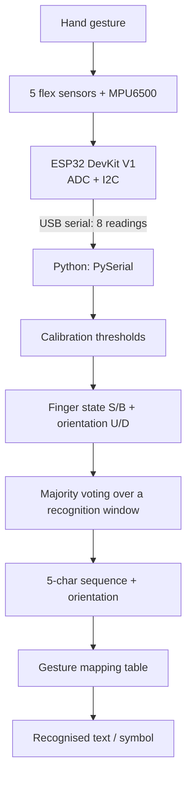

# GestureX 🧤

**Sensor-based hand gesture recognition using ESP32, flex sensors and an MPU6500.**

*(GestureX: Hand Gesture Vocaliser)*


gestureX is a low-cost, glove-based system that recognises a predefined set of hand gestures and converts them into text or symbols. Five flex sensors (one per finger) capture finger bending, and an MPU6500 accelerometer captures hand orientation (UP or DOWN). An ESP32 streams the readings to a computer over USB serial, where a Python program calibrates, classifies and maps them to an output character.

> **Scope note:** gestureX recognises only predefined gestures and is **not** a complete sign language translator. Recognition is **threshold-based** (calibration thresholds + majority voting); it does **not** use a trained machine-learning model. Speech output is a planned future extension.

---

## Table of Contents

- [Features](#features)
- [How It Works](#how-it-works)
- [Hardware](#hardware)
- [Circuit and Pin Connections](#circuit-and-pin-connections)
- [Software and Technologies](#software-and-technologies)
- [Calibration](#calibration)
- [Gesture Recognition and Majority Voting](#gesture-recognition-and-majority-voting)
- [Gesture Mapping Table](#gesture-mapping-table)
- [Web Dashboard](#web-dashboard)
- [Getting Started](#getting-started)
- [Repository Structure](#repository-structure)
- [Advantages and Limitations](#advantages-and-limitations)
- [Future Scope](#future-scope)
- [Authors](#authors)
- [Acknowledgements](#acknowledgements)

---

## Features

- Detects bending of all five fingers using flex sensors
- Detects hand orientation (UP / DOWN) using the MPU6500 accelerometer
- ESP32 firmware reads 5 analog channels (ADC) and the IMU (I2C)
- Streams 8 readings (5 flex + 3 accelerometer) to the computer over USB serial
- Four-stage calibration to adapt to different sensors, glove fit and hand positions
- Majority voting over multiple readings for stable output
- Maps recognised gestures (finger sequence + orientation) to text/symbols (A to Z)
- Web dashboard for live telemetry, calibration and gesture reading

---

## How It Works



1. The user wears the glove with five flex sensors and the MPU6500 on the back of the hand.
2. The ESP32 reads five analog voltages (flex sensors) and the accelerometer X, Y, Z values (I2C).
3. The eight readings are sent to the computer over USB serial.
4. Python classifies each finger as **Straight (S)** or **Bent (B)** and the orientation as **UP (U)** or **DOWN (D)** using calibration data.
5. Several readings are collected in a recognition window, and the most frequent state per finger and the most frequent orientation are selected.
6. The resulting five-character sequence plus orientation is looked up in the gesture table and the output is displayed.

---

## Hardware

| Component | Qty | Purpose |
|---|---|---|
| ESP32 DevKit V1 | 1 | Reads the analog sensor voltages and MPU6500 data; sends them over USB serial |
| Flex sensors | 5 | One per finger; resistance changes with bending |
| MPU6500 | 1 | Measures acceleration on 3 axes to determine orientation |
| 10 kΩ resistors | 5 | Fixed resistor of each flex sensor's voltage divider |
| Breadboard | 1 | Solderless circuit connections |
| Jumper wires | as required | Connections |
| Glove | 1 | Holds sensors in position |
| USB cable | 1 | Power and serial communication |

---

## Circuit and Pin Connections

Each flex sensor forms a voltage divider with a 10 kΩ resistor:

```
3.3 V → Flex Sensor (R1) → Junction (Vout → ESP32 ADC) → 10 kΩ (R2) → GND

Vout = Vin × R2 / (R1 + R2)
```

An increase in flex sensor resistance (more bending) lowers `Vout`.

### Flex sensors → ESP32

| Finger | ESP32 GPIO |
|---|---|
| Thumb | GPIO 34 |
| Index | GPIO 35 |
| Middle | GPIO 32 |
| Ring | GPIO 33 |
| Little | GPIO 36 |

### MPU6500 → ESP32 (I2C)

| MPU6500 Pin | ESP32 Connection |
|---|---|
| VCC | 3.3 V |
| GND | GND |
| SDA | GPIO 21 |
| SCL | GPIO 22 |

The ESP32 is the I2C master and the MPU6500 is the slave. Only accelerometer X, Y and Z readings are used; the gyroscope is not used for recognition.

<!-- Add your circuit diagram images here, e.g.:

-->

---

## Software and Technologies

| Technology | Purpose |
|---|---|
| Arduino IDE / ESP32 firmware | Reads flex sensors (ADC) and MPU6500 (I2C), sends readings over serial |
| Python | Calibration, classification, majority voting, gesture mapping |
| PySerial | Receives serial data from the ESP32 |
| FastAPI + WebSocket | Backend for the web dashboard |
| React + Vite | Web dashboard frontend |

---

## Calibration

Raw flex readings vary with sensor resistance, placement, glove fit and electrical conditions, so fixed thresholds would not work for every setup. gestureX collects readings in four calibration stages:

| Stage | Meaning |
|---|---|
| S | All fingers held straight |
| B | All fingers held bent |
| U | Hand held in UP orientation |
| D | Hand held in DOWN orientation |

- **Flex calibration:** the S and B stages give a per-finger threshold separating Straight from Bent.
- **Thumb rule (current implementation):** a reading of `0` is Straight; a non-zero reading is Bent.
- **Orientation calibration:** the U and D stages give a reference used to decide UP or DOWN from the accelerometer reading.

---

## Gesture Recognition and Majority Voting

A gesture is the pair **(finger sequence, orientation)**. The sequence is written thumb → little, with `S` = Straight and `B` = Bent. For example, `SBSSB` means thumb straight, index bent, middle straight, ring straight, little bent.

A single reading can be unstable (sensor fluctuation, slight movement, noise), so multiple readings are collected in a recognition window and the most frequent state of each finger and the most frequent orientation are selected. Majority voting reduces the effect of unstable readings but does not guarantee error-free recognition.

Illustrative example (not measured data):

| Reading | Thumb | Index | Middle | Ring | Little | Orientation |
|---|---|---|---|---|---|---|
| 1 | S | S | B | B | S | U |
| 2 | S | S | B | B | S | U |
| 3 | B | S | B | S | S | D |
| **Final (majority)** | **S** | **S** | **B** | **B** | **S** | **U** |

---

## Gesture Mapping Table

13 finger sequences × 2 orientations = 26 gestures (A to Z).

| Finger Sequence | UP (U) | DOWN (D) |
|---|---|---|
| `SBBBB` | A | N |
| `SSBBB` | B | O |
| `SSSSS` | C | P |
| `BSSSS` | D | Q |
| `BSBBB` | E | R |
| `SSSBS` | F | S |
| `SSSBB` | G | T |
| `SBBBS` | H | U |
| `BBBBS` | I | V |
| `BSSBB` | J | W |
| `BBSSS` | K | X |
| `SSBBS` | L | Y |
| `BBBBB` | M | Z |

---

## Web Dashboard

The web interface provides:

- Live telemetry and sensor stream (per-finger value and Straight/Bent state, MPU6500 orientation)
- ESP32 / WebSocket connection status
- Gesture recognition with a timed capture window, per-finger majority voting and dictionary lookup (single or continuous mode)
- Gesture map view
- Guided 4-stage calibration mode

---

## Getting Started

> Adjust the commands and paths below to match your actual repository layout.

### 1. Hardware setup

1. Mount the five flex sensors along the fingers of the glove and the MPU6500 on the back of the hand.
2. Wire everything as described in [Circuit and Pin Connections](#circuit-and-pin-connections).
3. Connect the ESP32 to your computer with a USB cable.

### 2. Flash the ESP32 firmware

1. Install the ESP32 board package in the Arduino IDE.
2. Open the firmware sketch from the `firmware/` folder.
3. Select **ESP32 Dev Module**, choose the correct COM port and upload.

### 3. Run the backend

```bash
cd backend
pip install -r requirements.txt
uvicorn main:app --reload
```

Set the serial port (e.g. `COM3` on Windows or `/dev/ttyUSB0` on Linux) in the backend configuration.

### 4. Run the frontend

```bash
cd frontend
npm install
npm run dev
```

### 5. Calibrate and use

1. Open the dashboard and go to **Calibration**.
2. Capture the four stages: Straight, Bent, Hand Up, Hand Down.
3. Click **Start Reading** and form a gesture to see the recognised output.

---

## Advantages and Limitations

| Advantages | Limitations |
|---|---|
| Uses commonly available hardware | Flex sensor readings vary with placement and bending |
| Captures finger bending and hand orientation | Calibration is required |
| Modular sensor-based approach | Sensor noise may affect recognition |
| Calibration handles sensor variation | Only predefined gestures can be identified |
| Extendable with additional gestures | Depends on a wired USB serial connection |
| Removable glove arrangement | Performance depends on calibration quality and sensor positioning |

No accuracy or performance figures are reported for this prototype.

---

## Future Scope

The following are proposals and not part of the current implementation:

- Larger gesture vocabulary and more gesture combinations
- Improved calibration and noise filtering
- More compact, portable hardware
- Wireless communication between the ESP32 and the computer
- Text-to-speech output
- Machine-learning-based gesture recognition
- Better reliability across different hand positions

---

## Developers

- **Chirag Maloo**
- **Sumit Mali**

B.Tech ICT, Department of Information and Communication Technology, School of Technology, Pandit Deendayal Energy University, Gandhinagar, Gujarat.

## Acknowledgements

Submitted to **Ms. Aarti Solanki** as the IoT project for July 2026 to November 2026.
